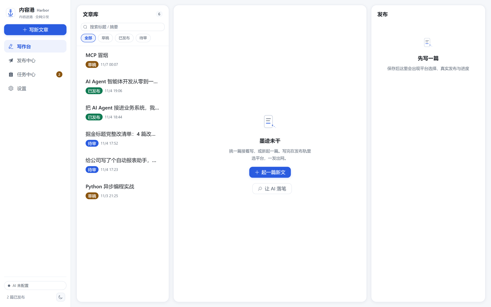
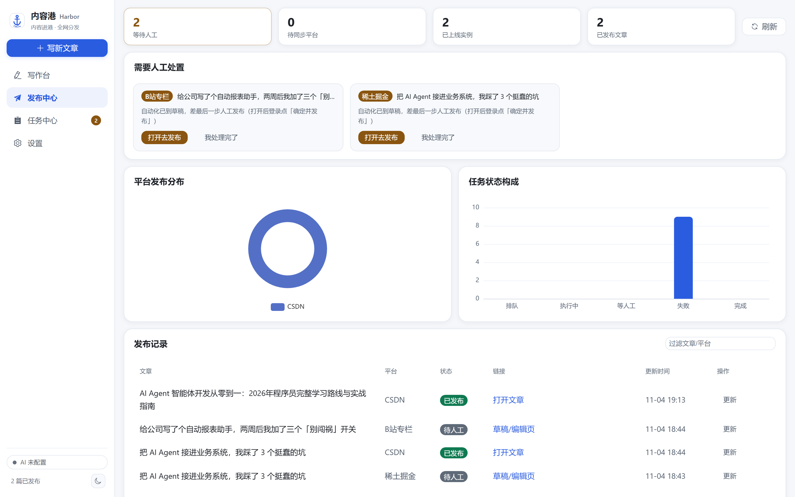
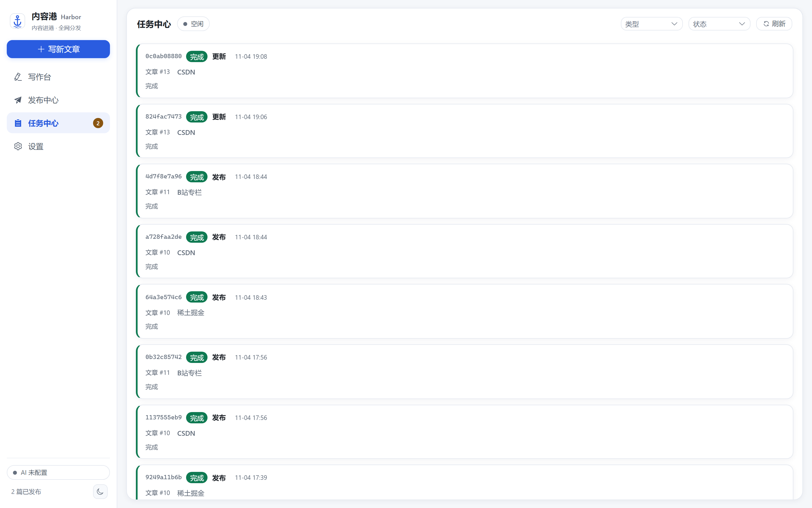
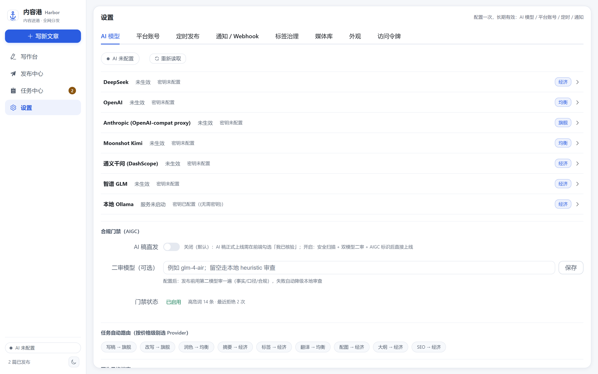
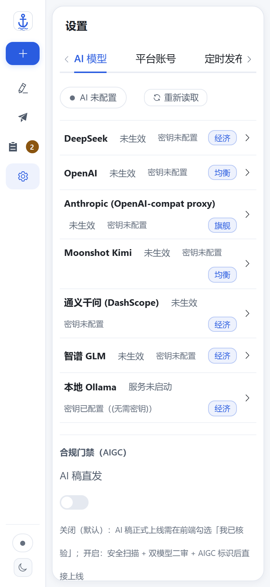
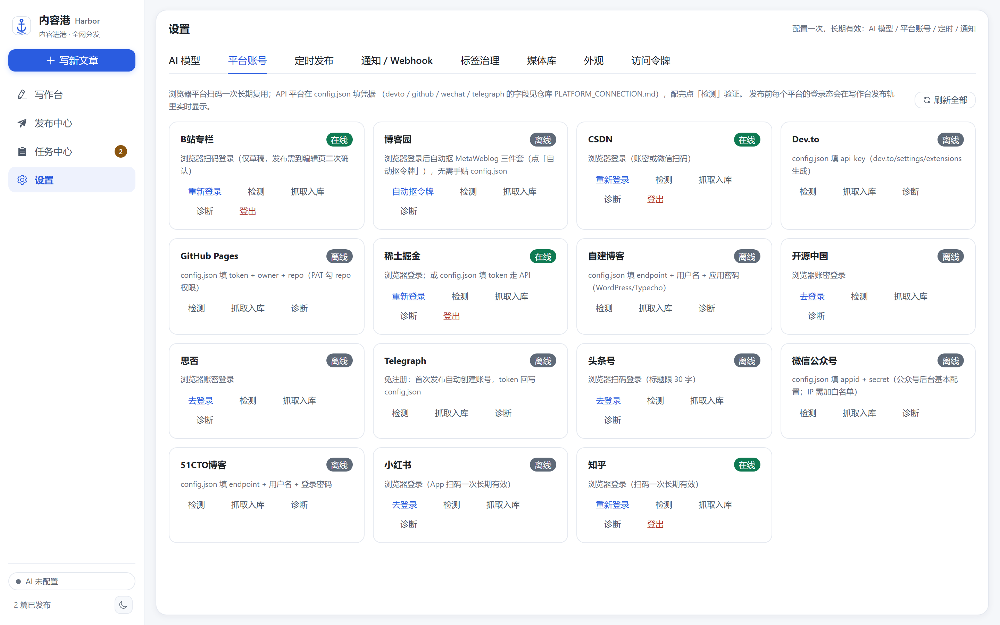
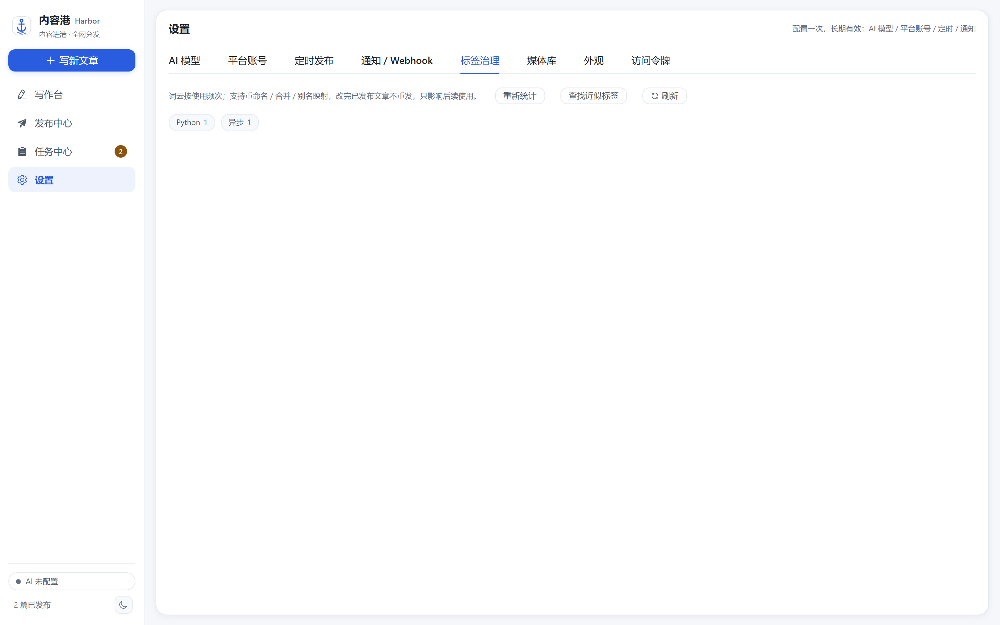

# Harbor

**English** · [简体中文](README.zh-CN.md)

Self-hosted publishing hub for people who write in Chinese and publish everywhere.
Write once, ship to fifteen platforms, and keep every published copy in sync — with AI
drafting, a compliance gate, and a human in the loop when a platform fights back.

[](https://github.com/badhope/harbor/actions/workflows/ci.yml)
[](LICENSE)



---

## What it does

| | |
|---|---|
| **Fifteen platforms, one publish action** | Zhihu, Juejin, CSDN, Bilibili, Cnblogs, Toutiao, OSChina, SegmentFault, 51CTO, MetaWeblog blogs, WeChat Official Accounts, GitHub Pages, Dev.to, Telegraph, Xiaohongshu. Each adapter declares what it can actually do — publish, draft, update, tags, cover, Q&A — and the UI greys out the rest. |
| **Update in place** | Edit once; every already-published copy is updated rather than duplicated. |
| **AI drafting with a compliance gate** | Seven provider routes with failover, plus a four-stage gate before anything ships: safety scan → AIGC disclosure → dual-model review → human confirmation. |
| **Pauses instead of guessing** | CAPTCHA, risk control, expired session: the task stops, tells you, and resumes where it left off. |
| **Session persistence** | Log in once per platform. Cookies live in a local profile plus an atomic snapshot, so a wiped profile does not force a re-scan. |
| **MCP server, 32 tools** | Drive the whole pipeline from Claude Code, Cursor or any MCP client. stdio, streamable-http or legacy SSE; any non-loopback transport requires a bearer token. |
| **Everything local, and portable out** | SQLite with FTS5 full-text search, local media store with content-addressed dedupe, no vendor account, no telemetry. Export any article — or the whole library — as Markdown with YAML front-matter for Hexo, Hugo or Obsidian. |
| **A live view that survives reconnects** | Task and article changes stream over SSE with monotonic event ids; after a dropped connection the client replays what it missed via `Last-Event-ID` instead of showing a stale "stuck" task. |
| **Measured, not asserted** | `/metrics` exports real Prometheus histograms, every release runs eight gates, and the desktop build is a tested single-file executable — not a claim in a README. |

## Screens

| Publish center | Task center |
|---|---|
|  |  |

| Settings | Mobile |
|---|---|
|  |  |



*Fifteen adapters, each declaring what it can actually do. Greyed-out actions are not supported by that platform, not missing features.*



*Tag governance finds near-duplicate tags (`Python` / `python` / `Pyhton`) and merges them in one click.*

## Quick start

Requires Python 3.10+, [uv](https://docs.astral.sh/uv/), Node 20+ and pnpm.

```bash
git clone https://github.com/badhope/harbor.git
cd harbor

# Terminal 1 — backend
cd backed
uv sync
uv run uvicorn app.factory:create_app --factory --host 127.0.0.1 --port 8000 --reload

# Terminal 2 — frontend
cd web
pnpm install
pnpm dev            # http://127.0.0.1:5173
```

Open <http://127.0.0.1:5173>. The Vite dev server proxies `/api` to port 8000.

### Command line

```bash
uv run --project backed python -m backed.cli status                 # library + account overview
uv run --project backed python -m backed.cli list                   # newest articles
uv run --project backed python -m backed.cli create --title "..." --content "..."
uv run --project backed python -m backed.cli publish --id 12 --platforms juejin,csdn
uv run --project backed python -m backed.cli export --all --out ./markdown
```

### Desktop shell (experimental)

```bash
cd web
pnpm install
pnpm run tauri dev
```

For a release build, stage the sidecar under the name Tauri expects first:

```bash
uv run --project backed python scripts/stage_sidecar.py   # copies dist/ -> binaries/<triple>
cd web && pnpm tauri build
```

Tauri launches the Python backend as a sidecar and reads its port from a handshake
file. **Verified on Windows** (2026-11-07): `tauri build` compiles, the app starts,
the sidecar binds a loopback port, and the data directory is created under
`%APPDATA%`. macOS and Linux are untested — see [Known limits](#known-limits).

## Connect a platform

Two connection styles, decided per platform:

**Browser login** — for platforms without a usable API. Open *Settings → Platform
accounts*, click **Log in** on the platform, and complete the scan or password step in
the window that opens. The session is stored in a local profile and reused.

```bash
uv run --project backed python -m backed.cli --headed login --platform zhihu
```

**Protocol credentials** — for platforms with a stable API. Fill in
`platforms.<name>` in `config.json`; no browser needed. See
[PLATFORM_CONNECTION.md](PLATFORM_CONNECTION.md) for the field list per platform.

```bash
uv run --project backed python -m backed.cli publish --id <article-id> --platforms zhihu,juejin
```

## Configuration

Edit `backed/config.json`, or use environment variables:

| Variable | Purpose | Default |
|---|---|---|
| `HARBOR_API_TOKEN` | REST authentication token | Auto-generated on loopback; **required** in production/Docker |
| `SECRET_KEY` / `HARBOR_SECRET_KEY` | Signing / JWT key | **Required** in production; no public default |
| `TRUSTED_NETS` | Client networks exempt from the API token | Loopback only |
| `TRUSTED_PROXIES` | Reverse proxies whose `X-Forwarded-For` is trusted | Empty |
| `CORS_ORIGINS` | Allowed cross-origin origins | Same-origin |
| `ALLOWED_HOSTS` | Accepted `Host` headers | Loopback |
| `HUB_DATA_DIR` | Persistent root for DB, media, profiles, config | Repo-local `data/` |
| `HUB_BROWSER_CHANNEL` | Reuse a system browser (`msedge` / `chrome`) | Bundled Chromium |
| `PUBLIC_BASE_URL` | Public base URL for hosted media | Empty (media stored, not rewritten) |
| `DEMO=1` | Demo mode: no browser, no external API calls | Off |

## Deployment

Docker Compose runs the backend behind nginx, with the token injected server-side:

```bash
export SECRET_KEY=$(openssl rand -hex 32)
export HARBOR_API_TOKEN=$(openssl rand -hex 32)
docker compose -f deploy/docker-compose.yml --profile web up -d --build
```

The backend is not exposed to the host; nginx terminates and injects the token. Data
lives in the `hub_data` volume.

## Testing

```bash
bash scripts/check_all.sh          # all gates; Linux/macOS
pwsh -File scripts/check_all.ps1   # all gates; Windows

cd backed && uv run pytest -q      # backend only
pnpm --dir web test                # frontend only
```

`check_all` runs eight gates: compileall, ruff, version consistency, secret scan,
pytest, eslint, vitest, vite build.

## Architecture

```
Vue 3 SPA  ──REST/SSE──►  FastAPI  ──►  Publishing hub
(Tauri shell)             (uvicorn)      ├── 15 platform adapters
                                         ├── task engine + scheduler
                                         ├── SQLite (WAL + FTS5)
                                         └── MCP bridge (stdio/SSE)
```

Details in [docs/architecture/ARCHITECTURE.md](docs/architecture/ARCHITECTURE.md).

## Known limits

Read this before trusting any claim above.

- **Browser fetch and screenshot are enabled but network-restricted.** The target host
  is pinned to its validated public IP inside Chromium and every sub-resource is
  checked. Private, loopback and link-local targets are rejected.
- **Real publishing is not regression-tested against live platform DOM.** Adapters pass
  a static contract probe; only Juejin has a captured DOM sample. Verify with a draft
  before relying on any platform.
- **Tauri is verified on Windows only.** `tauri build --no-bundle` compiles, the app
  launches, and the sidecar serves `/api/v1/hub/health` on a loopback port
  (2026-11-07). macOS/Linux and installer packaging (NSIS/MSI) are untested.
- **Docker is still unverified.** The daemon is unavailable on this machine; the
  compose file and Dockerfiles are lint-checked but have never produced a running
  container here.
- **No auto-update, no signed release manifest, no cross-platform installer.**

## Documentation

| | |
|---|---|
| [Project management](docs/PROJECT_MANAGEMENT.md) | Branch model, DoD, gates, five-remote sync |
| [Versioning](docs/VERSIONING.md) | SemVer policy and release checklist |
| [Roadmap](docs/ROADMAP.md) | Shipped, next, backlog, out of scope |
| [Platform guide](PLATFORM_CONNECTION.md) | Per-platform credentials and CLI |
| [Architecture](docs/architecture/ARCHITECTURE.md) | Module boundaries and data flow |
| [Verification records](docs/verification/index.md) | Dated evidence from real platforms, installers and deployments |
| [Audit reports](docs/audit/AUDIT.md) | Historical defect audits and fixes |
| [Contributing](CONTRIBUTING.md) | How to send a change |
| [Security](SECURITY.md) | Reporting vulnerabilities |

## License

MIT — see [LICENSE](LICENSE).
