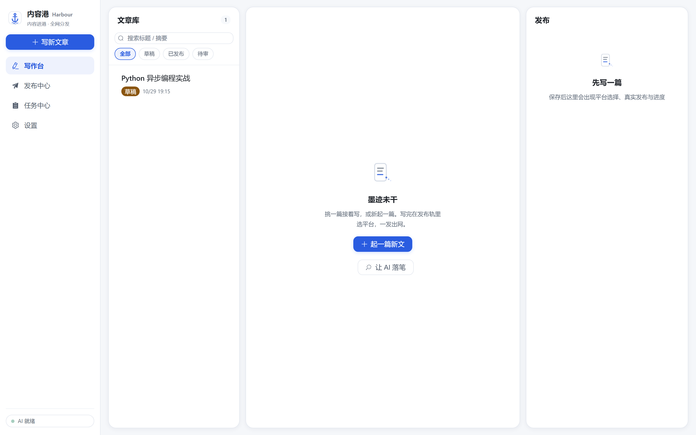
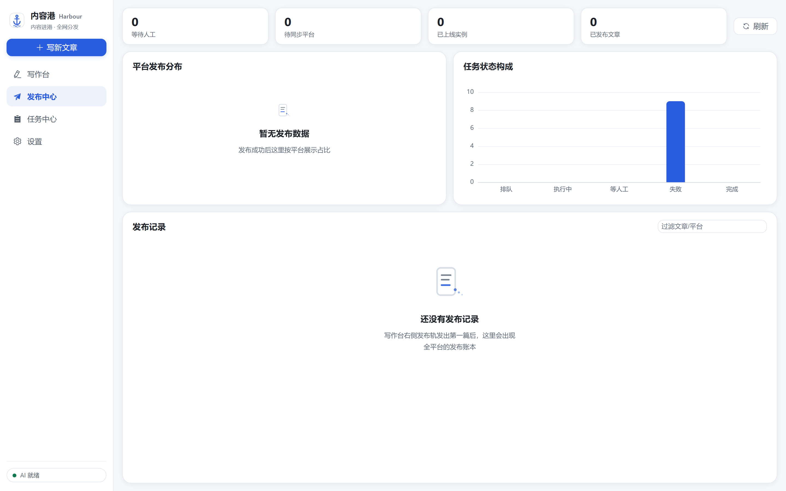
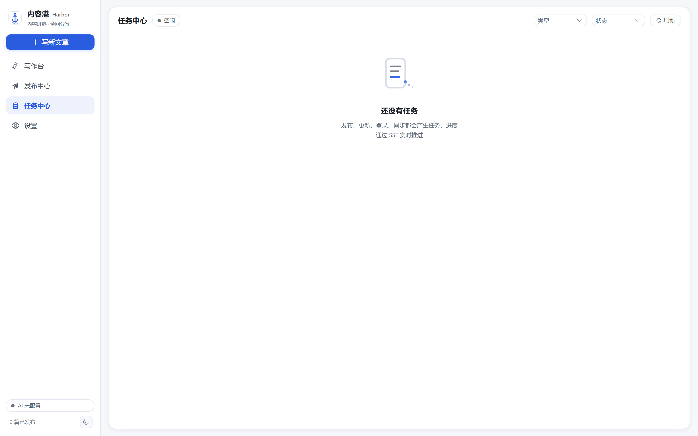
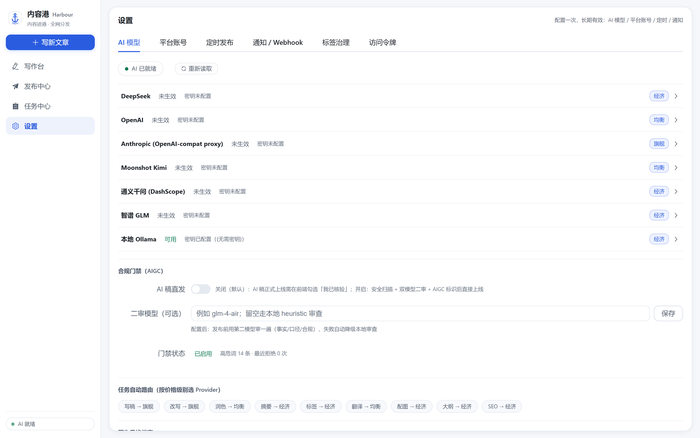
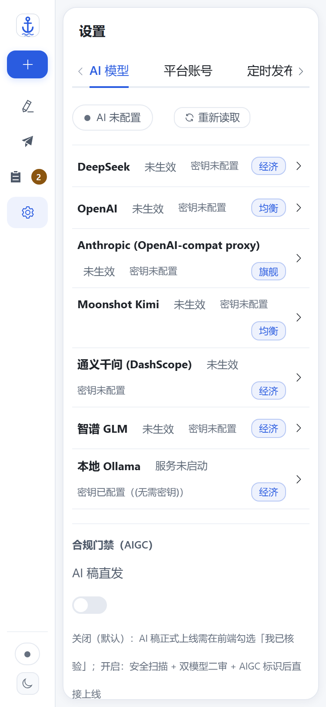
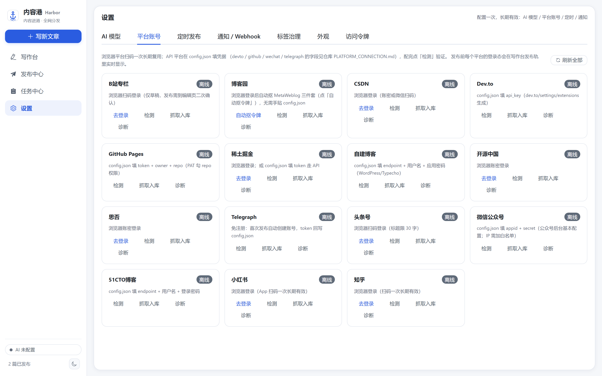
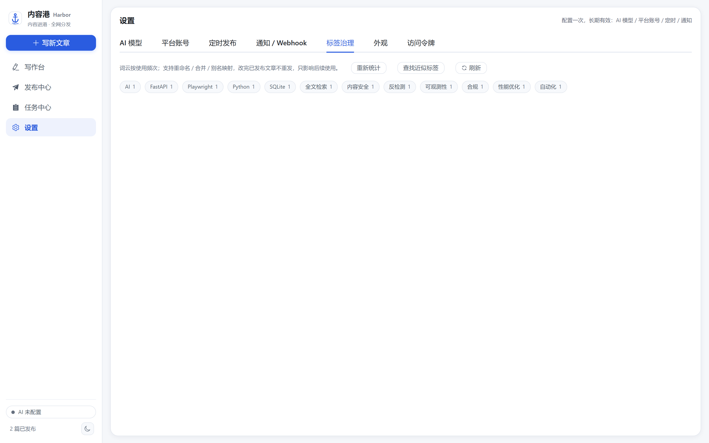

# Harbor 港

[English](README.md) · **简体中文**

面向中文创作者的自托管发布中枢：一次写作，分发到十五个平台，已发布的内容保持同步。
内置 AI 写稿、合规门禁，以及在平台风控拦截时把控制权交回给人的机制。

[](https://github.com/badhope/harbor/actions/workflows/ci.yml)
[](LICENSE)



---

## 能力

| | |
|---|---|
| **十五个平台，一次发布** | 知乎、掘金、CSDN、B站、博客园、头条、开源中国、SegmentFault、51CTO、MetaWeblog 自建博客、微信公众号、GitHub Pages、Dev.to、Telegraph、小红书。每个适配器声明自己真实支持的能力（发布/草稿/更新/标签/封面/问答），前端按声明置灰。 |
| **原地更新** | 改一次，所有已发布副本同步更新，不产生重复内容。 |
| **AI 写稿 + 合规门禁** | 七条 Provider 路由带故障转移；上线前四道闸门：安全扫描 → AIGC 标识 → 双模型审查 → 人工确认。 |
| **卡住就暂停，不瞎猜** | 验证码、风控、登录失效：任务停下并告知你，处理完从原处继续。 |
| **登录态持久** | 每个平台扫码一次。Cookie 存本地 profile 并额外做原子快照，profile 被清也不用重扫。 |
| **MCP Server，32 个工具** | 可从 Claude Code、Cursor 或任意 MCP 客户端驱动整条流水线。支持 stdio / streamable-http / 旧版 SSE；非回环地址一律强制 Bearer Token。 |
| **全部本地，也能带得走** | SQLite + FTS5 全文检索，媒体内容寻址去重，无厂商账号，无遥测。任意文章或整个库都能导出为带 YAML front-matter 的 Markdown，Hexo / Hugo / Obsidian 直接可用。 |
| **断线也不装死** | 任务与文章变更经 SSE 推送，事件带单调 id；断线重连时客户端按 `Last-Event-ID` 补发缺口，而不是显示一个"卡住"的旧状态。 |
| **可测量，不靠宣称** | `/metrics` 输出真实 Prometheus 直方图，每次提交跑八道门禁，桌面版是实测过的单文件可执行程序。 |

## 界面

| 发布中心 | 任务中心 |
|---|---|
|  |  |

| 设置 | 移动端 |
|---|---|
|  |  |



*十五个适配器，每个都声明自己真实支持的能力。置灰的动作是平台不支持，不是功能缺失。*



*标签治理自动找出近似重复标签（`Python` / `python` / `Pyhton`），预览后一键合并。*

## 快速开始

需要 Python 3.10+、[uv](https://docs.astral.sh/uv/)、Node 20+ 与 pnpm。

```bash
git clone https://github.com/badhope/harbor.git
cd harbor

# 终端 1 —— 后端
cd backed
uv sync
uv run uvicorn app.factory:create_app --factory --host 127.0.0.1 --port 8000 --reload

# 终端 2 —— 前端
cd web
pnpm install
pnpm dev            # http://127.0.0.1:5173
```

打开 <http://127.0.0.1:5173>，Vite 会把 `/api` 代理到 8000 端口。

### 命令行

```bash
uv run --project backed python -m backed.cli status                 # 库与账号总览
uv run --project backed python -m backed.cli list                   # 最新文章
uv run --project backed python -m backed.cli create --title "..." --content "..."
uv run --project backed python -m backed.cli publish --id 12 --platforms juejin,csdn
uv run --project backed python -m backed.cli export --all --out ./markdown
```

### 桌面形态（实验）

```bash
cd web
pnpm install
pnpm run tauri dev
```

Tauri 以 sidecar 方式拉起 Python 后端。**跨平台打包尚未验证**，见「已知限制」。

## 接入平台

两类接入方式，按平台决定：

**浏览器登录** —— 没有可用 API 的平台。打开「设置 → 平台账号」，点该平台的「登录」，
在弹出窗口里完成扫码或输密码。登录态存进本地 profile，之后长期复用。

```bash
uv run --project backed python -m backed.cli --headed login --platform zhihu
```

**协议凭据** —— 有稳定 API 的平台。在 `config.json` 里填 `platforms.<名>`，免浏览器。
字段清单见 [PLATFORM_CONNECTION.md](PLATFORM_CONNECTION.md)。

```bash
uv run --project backed python -m backed.cli publish --id <文章ID> --platforms zhihu,juejin
```

## 配置

编辑 `backed/config.json`，或用环境变量：

| 变量 | 用途 | 默认 |
|---|---|---|
| `HARBOR_API_TOKEN` | REST 鉴权 Token | 回环下自动生成；生产/Docker **必须**显式设置 |
| `SECRET_KEY` / `HARBOR_SECRET_KEY` | 签名 / JWT 密钥 | 生产**必须**设置，不使用公开默认值 |
| `TRUSTED_NETS` | 免 Token 的客户端网段 | 仅回环 |
| `TRUSTED_PROXIES` | 允许采信 `X-Forwarded-For` 的反向代理网段 | 空 |
| `CORS_ORIGINS` | 跨域白名单 | 同源 |
| `ALLOWED_HOSTS` | 接受的 `Host` 头 | 回环 |
| `HUB_DATA_DIR` | 数据库/媒体/登录态/配置的持久根 | 仓库内 `data/` |
| `HUB_BROWSER_CHANNEL` | 复用系统浏览器（`msedge` / `chrome`） | 自带 Chromium |
| `PUBLIC_BASE_URL` | 托管媒体的对外基地址 | 空（只入库不改写） |
| `DEMO=1` | 演示模式：不开浏览器、不调外部 API | 关 |

## 部署

Docker Compose 把后端藏在 nginx 后面，Token 由服务端注入：

```bash
export SECRET_KEY=$(openssl rand -hex 32)
export HARBOR_API_TOKEN=$(openssl rand -hex 32)
docker compose -f deploy/docker-compose.yml --profile web up -d --build
```

后端不对宿主暴露端口；nginx 负责终止连接并注入 Token。数据落在 `hub_data` 卷。

## 测试

```bash
bash scripts/check_all.sh          # 全部门禁；Linux/macOS
pwsh -File scripts/check_all.ps1   # 全部门禁；Windows

cd backed && uv run pytest -q      # 只跑后端
pnpm --dir web test                # 只跑前端
```

`check_all` 覆盖八道门禁：compileall、ruff、版本一致性、密钥扫描、pytest、
eslint、vitest、vite build。

## 架构

```
Vue 3 SPA  ──REST/SSE──►  FastAPI  ──►  发布中枢
(Tauri 外壳)              (uvicorn)      ├── 15 个平台适配器
                                         ├── 任务引擎 + 调度器
                                         ├── SQLite（WAL + FTS5）
                                         └── MCP 桥（stdio/SSE）
```

详见 [docs/architecture/ARCHITECTURE.md](docs/architecture/ARCHITECTURE.md)。

## 已知限制

在看懂这一节之前，不要完全相信上面的描述。

- **浏览器抓取与截图已启用，但受网络限制。** 目标主机会在 Chromium 内部钉扎到已校验的
  公网 IP，每个子资源都会再校验一次；私网、回环、链路本地地址一律拒绝。
- **真实发布没有对线上平台 DOM 做回归。** 适配器只通过静态契约探针，只有掘金有采集到
  的 DOM 样本。依赖任何平台前，请先用草稿试发。
- **Docker 与 Tauri 构建在本机未验证。** Docker daemon 不可用；Tauri 卡在本机 linker
  错误。compose 文件与 sidecar 脚本存在，但这里没有产出过通过验证的安装包。
- **没有自动更新、没有签名发布清单、没有跨平台安装程序。**

## 文档

| | |
|---|---|
| [项目管理](docs/PROJECT_MANAGEMENT.md) | 分支模型、完成定义、门禁、五仓同步 |
| [版本管理](docs/VERSIONING.md) | SemVer 策略与发布清单 |
| [路线图](docs/ROADMAP.md) | 已交付 / 下一步 / 待排期 / 明确不做 |
| [平台接入](PLATFORM_CONNECTION.md) | 各平台凭据与 CLI |
| [架构](docs/architecture/ARCHITECTURE.md) | 模块边界与数据流 |
| [验证记录](docs/verification/) | 人工检查的带日期证据 |
| [审计报告](docs/audit/AUDIT.md) | 历史缺陷审计与修复记录 |
| [贡献指南](CONTRIBUTING.md) | 如何提交改动 |
| [安全策略](SECURITY.md) | 漏洞上报方式 |

## 许可

MIT —— 见 [LICENSE](LICENSE)。
